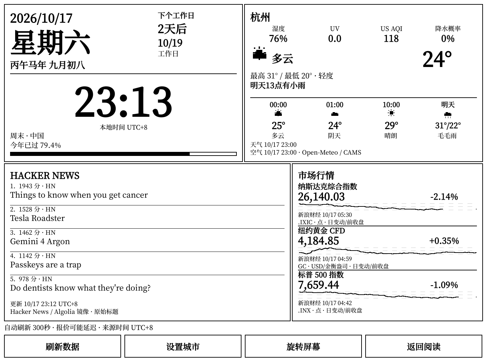
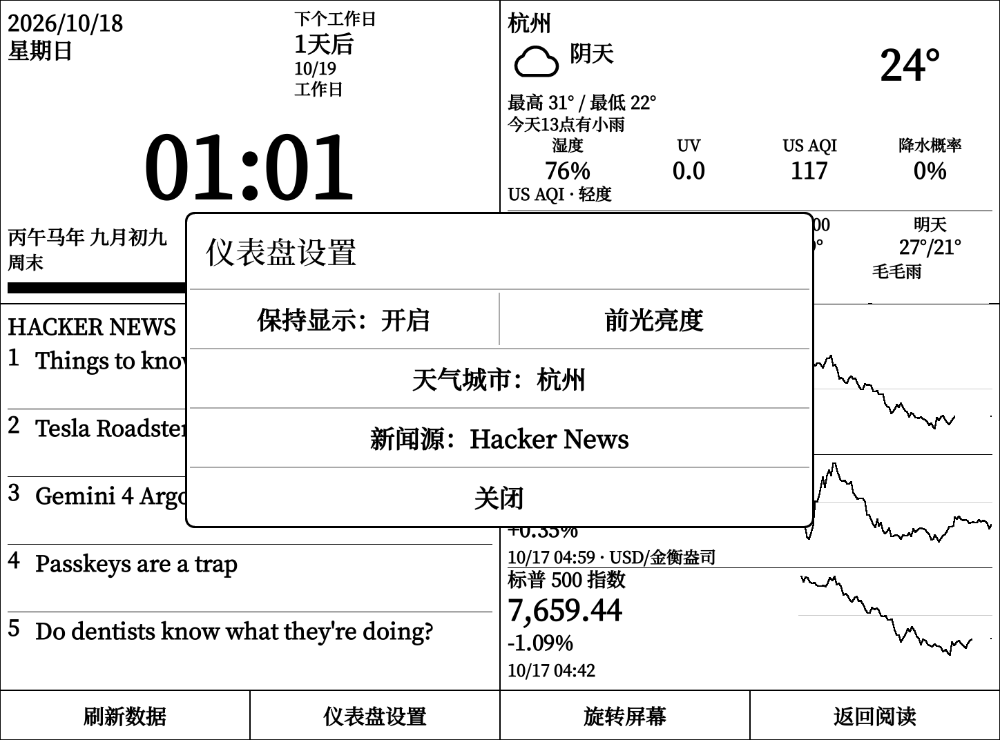
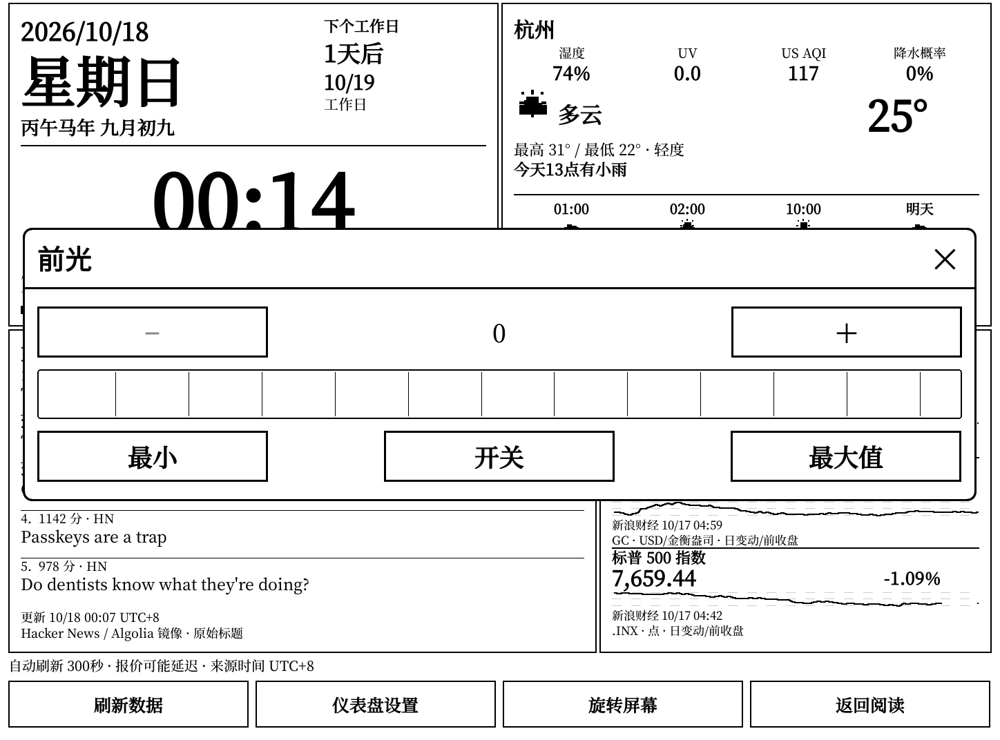

# Kindle Dashboard

[English](README-en.md)

运行在 KOReader 内的 Kindle 原生阅读仪表盘。界面由 KOReader 的 Lua 控件直接绘制，Kindle 直接通过 HTTPS 获取公开数据，无需自建服务器或 API Key。界面目前以中文为主。



## 面板与数据

- **日历与时钟**：公历、星期、农历（数据范围 1900—2100 年）、干支生肖、年度进度、中国工作日/休息日及下一次切换倒计时。时钟与日历使用固定 UTC+8，每分钟本地更新，不依赖网络。
- **天气与空气质量**：默认新加坡，可搜索中英文城市。显示温度、天气、湿度、UV、降水概率、最高/最低温、雨雪时段提示、三个后续时段预报和明日预报。数据来自 [Open-Meteo](https://open-meteo.com/)，空气质量来自其 CAMS 数据，面板使用 **US AQI**，不是中国 AQI。预报时段及“今天/明天”按所选城市时区计算；来源时间显示为 UTC+8。第三个预报时段会结合默认 10:00/18:00 工作时段选择。
- **行情**：通过新浪财经获取纳斯达克综合指数 `gb_ixic`、纽约黄金 CFD `hf_GC`、标普 500 指数 `gb_inx`。黄金单位为美元/金衡盎司，**该数据源标的是 CFD，并非 COMEX 近月期货或现货黄金**。展示报价、相对来源前收盘价的日变动及分时走势。美股指数走势来自五分钟数据，黄金走势来自分钟数据；缺失数据不补值，较长间隔保留为空缺。
- **Hacker News**：优先从 [官方 Firebase API](https://github.com/HackerNews/API) 的 top/best 列表获取新闻；列表不可用、无效或条目获取不完整时，改用 [Algolia 镜像](https://hn.algolia.com/api)。镜像分别取 front_page 和最近七天高分故事的前十个候选，沿用热度、时间、评论和标题关键词排序、去重及热点突出规则，最多展示五条。镜像的高分故事列表不保证与 Firebase best 排序一致，面板会标注 `Hacker News / Algolia 镜像`。保留原始标题、分数、时间和链接，不提供翻译或 AI 摘要；两种来源均失败时保留旧新闻及原抓取时间。也可设置自定义 HTTPS JSON 新闻源。

行情来源为[新浪财经](https://finance.sina.com.cn/)，Kindle 直接获取报价和走势，无需代理。报价可能延迟，休市时可能仍显示上一交易时段的数据。美股走势来源时间按纽约时区解析，黄金分时来源时间按 UTC+8 解析，界面统一显示 UTC+8。行情和天气标注来源观测时间，新闻标注抓取时间；联网成功不代表数据刚刚产生。缺少数值或时间时显示空缺/`--`，不会用示例值填充。

中国节假日随包提供 2026 年安排，数据来自 [NateScarlet/holiday-cn](https://github.com/NateScarlet/holiday-cn)。切换到未缓存年份时会尝试下载当年安排，失败后至多每天重试一次。未取得对应年度数据时，仅以周末规则估算，并标记“节假日估算”；调休与法定假期不能据此保证准确，跨年的倒计时也可能涉及估算。

## 安装

需要已越狱 Kindle 和已安装的 KOReader。使用 KUAL 入口还需安装 KUAL；Moon 是可选项。已在 Paperwhite 3、KOReader 2026.07.2、Moon 0.2.10 上验证四个面板显示、真实报价与曲线、城市搜索与选择，以及刷新期间打开设置和返回后的方向恢复。

通过 USB 复制以下两个目录，合并目标目录，不要替换整个 KOReader 安装：

```text
plugins/kindledashboard.koplugin → Kindle 根目录/koreader/plugins/kindledashboard.koplugin
extensions/Kindle-Dashboard    → Kindle 根目录/extensions/Kindle-Dashboard
```

安全弹出设备后重启 KOReader 一次。KUAL 启动脚本 `extensions/Kindle-Dashboard/bin/boot.sh` 需要可执行权限。

也可在已配置 SSH 密钥登录的电脑上，从仓库目录运行：

```sh
sh scripts/deploy.sh KINDLE_IP
# 可选：SSH 端口（默认 2222）、私钥路径
sh scripts/deploy.sh KINDLE_IP 2222 ~/.ssh/id_ed25519
```

脚本以 `root` 登录，检查 `/mnt/us/koreader`，复制插件与 KUAL 入口并设置启动权限；不会安装 KOReader。可用 `DASHBOARD_SSH_KNOWN_HOSTS` 指定 known_hosts 文件。部署后仍需重启 KOReader。

## 使用与设置

在 KOReader 中打开 **More tools（更多工具） > 阅读仪表盘**。安装 Moon 且其公开 `desktop.tabs` 扩展点可用时，桌面还会显示 **仪表盘** 标签。也可从 KUAL 的 **Kindle-Dashboard > Open Dashboard** 启动 KOReader 并自动打开仪表盘；若 KOReader 已运行，请使用其内部菜单。

底部按钮提供 **刷新数据**、**仪表盘设置**、**旋转屏幕** 和 **返回阅读**。设置对话框提供保持显示、前光亮度、天气城市和新闻源。城市搜索无结果时可尝试英文名称。自定义新闻地址必须为 HTTPS，留空恢复 Hacker News，响应为 JSON 数组，例如：

```json
[{"title":"新闻标题","meta":"来源说明","url":"https://example.com/story","time":1792195200}]
```

最多读取前五项；`title` 必填，其他字段可选，`time` 为 Unix 秒。

**保持显示**默认开启，仅在仪表盘打开时阻止自动屏保和自动休眠；关闭开关或返回阅读后，恢复进入前的保持唤醒状态。电源键仍可手动休眠，期间暂停刷新，唤醒后按已保存的开关恢复。Kindle 使用原生屏保计时接口，保留手动休眠能力。

**前光亮度**打开 KOReader 原生前光面板，支持滑块、加减、最小值、最大值与开关。调整立即生效，并在返回阅读后保留所选亮度。保持显示不会自动打开前光；保持设备运行和提高前光亮度都会增加耗电。





打开时会尝试刷新，此后每轮完成后等待 300 秒再刷新。自动刷新不会主动打开断开的 Wi-Fi；手动刷新可进入 KOReader 的联网流程。网络请求在可取消的子进程中进行，轻触可取消等待。各数据源失败时尽量保留相应缓存、原始时间和旧数据标记；首次使用且无缓存时显示空缺。离线时本地时钟与日历仍可工作。

旋转使用 KOReader 原生屏幕方向接口，不需要填写机型旋转编号。点击“返回阅读”关闭仪表盘，恢复进入前的方向和阅读器/文件管理器；Moon 桌面会按恢复后的方向重新布局，无需重启设备。

设置与缓存位于 KOReader 的设置目录（通常为 `/mnt/us/koreader/settings/`）：

- `kindledashboard.lua`：保持显示开关、天气城市、坐标、时区与自定义新闻地址；前光设置由 KOReader 管理。
- `kindledashboard-cache.json`：最近数据快照，重启后先作为旧数据展示。

刷新周期和三个行情标的当前在插件 `market.lua` 的默认配置中定义，设置界面未提供对应选项。

## 验证与排查

安装后确认菜单入口可见，再检查四个面板、城市切换、手动与自动刷新、断网保留旧数据、横竖屏切换及返回阅读后的方向恢复。使用 Moon 时也应检查桌面标签入口。查看来源时间和旧数据标记，避免把缓存误认为实时数据。

真机验证覆盖了中文搜索“杭州”、选择“杭州 · 浙江 · 中国”，以及刷新期间点击“仪表盘设置”和“返回阅读”。设置弹窗显示在仪表盘上方；取消刷新后先完成控件重绘，再处理按钮点击，避免点击丢失或触摸反馈错误。保持显示验证包括开关保存、重复打开/关闭、恢复原来的保持唤醒状态，以及电源键休眠和唤醒恢复；前光验证包括滑块、加减和开关，并核对实际硬件亮度。

KUAL 启动日志位于 `/tmp/kindle-dashboard-launch.log`；插件加载或运行问题可查看 KOReader 的 `crash.log`。公共数据接口的可用性、限流和地区网络访问会影响刷新结果。

本项目采用 MIT 许可证。
